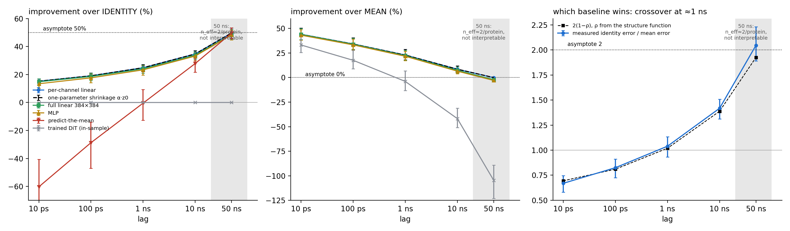
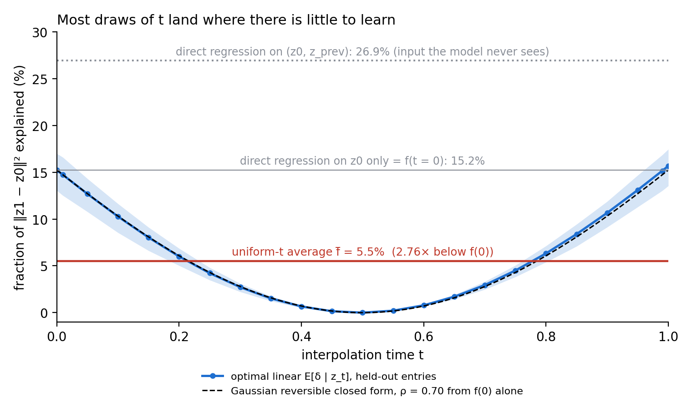
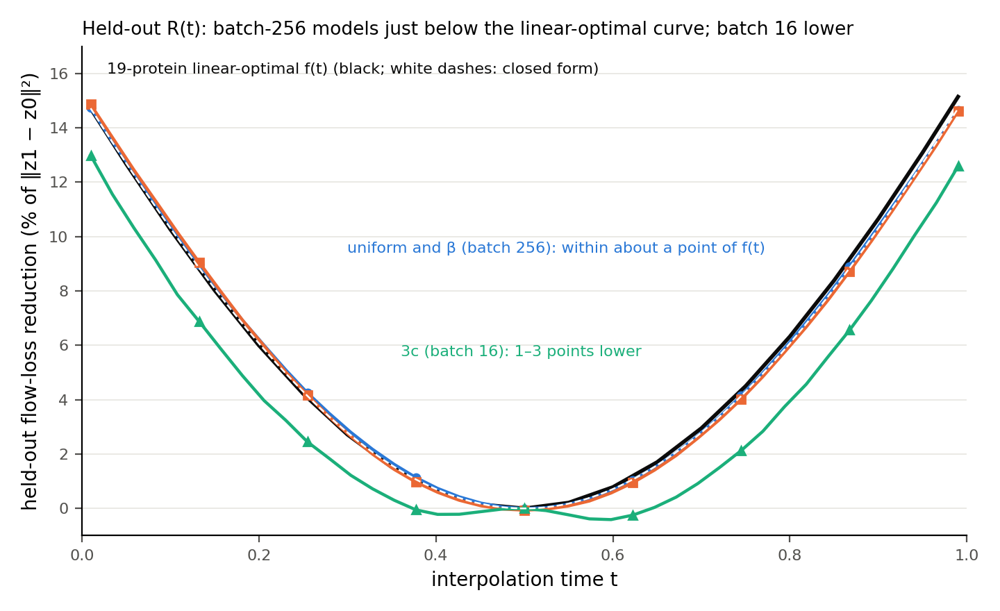

# Fluxion

Code and measurement pipeline for a study of whether frozen structure-predictor latents support learning protein dynamics. The study finds three measurement hazards that change reported scores by points to tens of points, that the short-lag signal a per-residue probe can recover from frozen Chai-1 latents is mean reversion, and that the exact sampler of the flow-matching formulation we tested is the identity map.

*Status: accompanies a manuscript in preparation. A link to the paper will be added when it is public.*

## Findings

**1. Three measurement hazards change reported numbers (paper Section 3).**
*Bucket padding.* Chai-1 pads each input to a fixed bucket, and the trunk emits activations at the padded positions. In our extraction their values were constant within a shard, differed between shards, and tracked the GPU type that wrote them, as far as we tested. Counting them raised an MLP's apparent improvement over a mean baseline from 45.5% to 82.8% on 19 proteins, an inflation of 37 points. The mask must come from the sequence length (`fluxion.analysis.mask`), never from the activations.
*Extraction non-determinism.* Re-extracting identical frames, even on identical hardware, gives different latents: the difference is independent per-frame noise whose mean square is 7% to 41% of the 10 ps displacement it is read against, and it varies between proteins.
*Baseline choice.* Whether an identity baseline or a mean baseline is harder to beat depends on the lag. With a protein's own mean the crossover is near 1 ns, and with the mean of other replicas it lies between 1 and 10 ns.

**2. Per-residue probes recover mean reversion at short lags (Section 4).** At 10 ps, one coefficient that contracts a frame toward the protein's known mean captures about 10% of the identity error (10.3% once the mean comes from other replicas and the measured extraction noise is removed; 15.2% as first measured). A full linear map and an MLP do no better. Matched-dimension C-alpha coordinates and the latents are indistinguishable on the shrinkage-referenced comparison; a lead for the latents in a weaker probe class is unexplained.

**3. The objective's exact sampler is the identity (Sections 5 and 6).** For the unconditioned, noiseless data-to-data flow of a stationary reversible process with a locally Lipschitz conditional-mean field, the exact flow map between two frames is the identity. One Euler step, the conditional-mean forecast, is therefore the most a point-forecast sampler can offer, and uniform time sampling can attain only 33 to 43% of the endpoint signal (the attenuation lies between 2.33 and 3.0; we measure 2.76 [2.73, 2.80] against a predicted 2.81, close but just outside the measured interval). Small flow models never exceed the per-channel linear optimum on held-out proteins, and the runs that trained without a mid-training collapse come within 1.3 points of it. An earlier, larger run that recovered nothing remains unexplained (Section 7.1).

<p align="center"></p>
<p align="center"> </p>

## Installation

Python 3.10 or newer.

```bash
git clone https://github.com/lehendo/fluxion.git && cd fluxion
pip install -e .              # analysis, training and evaluation code (CPU is enough for the analyses)
pip install -e ".[extract]"   # adds chai-lab 0.6.1, needed only to extract latents (GPU)
pip install -e ".[dev]"       # adds pytest
```

The pinned versions we verified together are Python 3.10, torch 2.6, chai-lab 0.6.1 and MDAnalysis 2.9. `chai-lab` downloads the Chai-1 weights on first use.

## Reproducing the paper

`paper_results/` holds the saved outputs behind every figure, table and number in the paper (JSON, CSV and text summaries; no coordinates and no latents). `MANIFEST.md` lists the configs and seeds of every training run and the script that produces each saved result.

**Without a GPU or any data**
```bash
python scripts/make_figures.py        # figures, text reports and paper_results/tables.md from paper_results/
python examples/synthetic_hazards.py  # the three hazards in miniature, on synthetic latents (seconds)
pytest                                # test suite
```

**From extracted latents (CPU).** Latents are not distributed: they derive from ATLAS trajectories, whose terms of use apply (see `NOTICE`), so you extract them yourself. Set `FLUXION_DATA` (and optionally `FLUXION_ATLAS_10PS`; see `src/fluxion/paths.py`), then:

1. `python scripts/fetch_atlas_trajectories.py` downloads the ATLAS trajectories (`scripts/fetch_atlas_sequences.py` the analysis archives).
2. `python -m fluxion.data_pipeline.extract_latents --pdb <p>.pdb --traj <p>_R1.xtc --out-dir $FLUXION_DATA/latents/<p> --shard-prefix <p>_R1` extracts one replica (GPU; about 1.5 s per frame on an A100-class card, roughly 240 GPU-hours for 19 proteins and three replicas).
3. `python scripts/build_extraction_metadata.py --from-latents $FLUXION_DATA/latents` and `python -m fluxion.data_pipeline.compute_norm_stats --latents-dir $FLUXION_DATA/latents`.
4. Run the analysis scripts named in `MANIFEST.md`. Each has a one-line docstring naming the paper artifact it produces. We checked this chain on the cluster: a fresh install rebuilt one protein's row cache bit-identically from the shards and reproduced the saved headline (604 numbers to 1e-5) and the saved 10 ps probe fit.

**Training** (GPU). `fluxion.training.train_t3` trains the 9M-parameter arms (about 3.5 h each on one H100 slice) and `scripts/phase3_eval.py` evaluates them. `fluxion.training.train` is the DDP trainer of the original 40M run (four A100s for about 71 hours). `examples/slurm_template.sbatch` and `guides/slurm_preemption.md` show how it checkpoints on preemption.

**What will not reproduce bit for bit.** Re-extraction adds fresh per-frame noise, the padded values depend on the GPU type, and kernels are non-deterministic, so a seed fixes data order and initialization but not the bits of a latent or a checkpoint. Expect agreement within the extraction noise the paper measures (Section 3.2). `paper_results/` is what the paper reports.

## What is here

| path | contents |
|---|---|
| `src/fluxion/data_pipeline/` | ATLAS fetching, per-frame Chai-1 conditioning, latent extraction, dataset and normalization |
| `src/fluxion/model/` | the diffusion transformer |
| `src/fluxion/training/` | flow-matching loss, trainers, checkpointing |
| `src/fluxion/inference/` | rollout and decoding of generated latents (not used for the paper's results) |
| `src/fluxion/analysis/` | masks, probes, statistics, the identity-flow theory, noise recomposition, template features |
| `scripts/` | one script per paper figure, table or number |
| `guides/` | short notes on the infrastructure and the failure each piece fixes |
| `examples/` | a synthetic-data walkthrough and a Slurm template |
| `paper_results/`, `MANIFEST.md`, `manifest.json` | saved results and the map from each to its script, config and seed |

## Limitations and what we do not claim

- **Scope of the claims.** We do not claim a generative advantage for frozen-representation models, a new principle for allocating training across noise levels (that principle is established), or an explanation of the original null. We do not claim that other work violates our measurement practices, and we did not test whether the padding artifact exists in other structure predictors.
- **Scope of the study.** It uses one structure-prediction trunk, one MD database and per-residue probes, so it cannot speak to coupling between residues.
- **Statistical power.** The flow-model comparisons use four held-out PDB entries and mostly one seed per configuration, and every held-out score is transductive: the per-channel normalization uses all 19 proteins and each protein's own mean is subtracted (paper Sections 2 and 7.3).

## Questions

Please open a [GitHub issue](https://github.com/lehendo/fluxion/issues).

## Citation

A citation will be added when the paper is public.

## Licence and attribution

The code is released under the Apache License 2.0 (`LICENSE`). Third-party software and data are covered in `NOTICE`: chai-lab 0.6.1 (Apache-2.0, code and weights), MDAnalysis (LGPL-3.0 or later), and the ATLAS database, which is governed by its own terms of use (stated on the ATLAS website) and must be cited as Vander Meersche et al., *Nucleic Acids Research* 52(D1):D384-D392 (2024), doi:10.1093/nar/gkad1084.  Check those terms before redistributing latents extracted from ATLAS trajectories.
